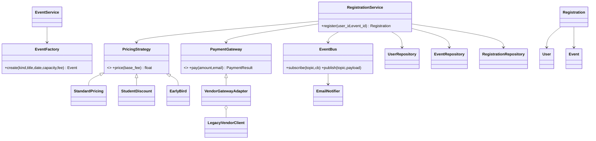

# 2. Design Patterns and UML

| Pattern | Problem solved | Alternative rejected (why) |
|---|---|---|
| Factory Method (creational) `EventFactory` | Each event kind has different defaults/validation | if/elif in routes – duplicated, hard to extend |
| Strategy (behavioral) `PricingStrategy` | Price rules change often | Conditionals in service – violates open/closed |
| Observer (behavioral) `EventBus` | Registration must trigger e-mail without coupling | Direct mailer call – service knows every consumer |
| Adapter (structural) `VendorGatewayAdapter` | Vendor SDK uses cents/tokens, incompatible interface | Calling SDK directly – vendor lock-in, untestable |

## UML class diagram (Mermaid – paste into https://mermaid.live and export PNG)

